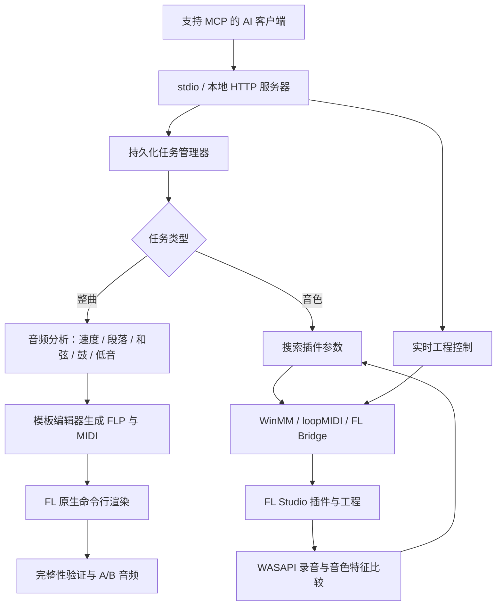

# FL Studio MCP

**用自然语言操作 FL Studio，并把参考音频转换成可编辑工程，或在现有插件中搜索接近的音色。**

[](https://github.com/Funkierry/fl-studio-mcp/actions/workflows/tests.yml)
[](https://github.com/Funkierry/fl-studio-mcp/releases/tag/v0.6.0)
[](LICENSE)

[下载 Windows EXE](https://github.com/Funkierry/fl-studio-mcp/releases/latest) · [参数示例](examples/) · [报告问题](https://github.com/Funkierry/fl-studio-mcp/issues)

FL Studio MCP 是运行在本机的 Model Context Protocol（MCP）服务器。支持 MCP 的 AI 客户端负责理解你的话，再通过本项目读取工程、写鼓点、控制插件、录制试听并分析结果。它本身不需要模型 API Key，也不内置大语言模型。

当前版本 **0.6.0** 提供 **31 个工具**。完整还原任务使用独立后台进程，工具连接关闭后仍可继续运行；重连后可查询进度和结果。

> **当前“整曲还原”的含义**：根据参考音频，近似重建 4/4 拍音乐的鼓、三和弦、低音和段落，再通过你准备的乐器模板生成 FLP、MIDI 和 WAV。当前不包含人声分离、独立主旋律转录、逐轨音色自动匹配或一比一成品复刻。

## 目录

- [1. 能做什么](#features)
- [2. 环境与兼容性](#requirements)
- [3. 安装与首次连接](#install)
- [4. 完整音乐还原](#song)
- [5. 单音色还原](#sound)
- [6. 日常编曲与试听](#arrange)
- [7. 工具与参数参考](#tools)
- [8. 数据、任务与恢复](#data)
- [9. 工作原理](#architecture)
- [10. 常见问题](#troubleshooting)
- [11. 开发、测试与打包](#development)
- [12. 验证结果与能力边界](#validation)
- [13. 许可证与参考资料](#license)

<a id="features"></a>
## 1. 能做什么

| 功能 | 输入 | 结果 | FL 是否需要打开 |
| --- | --- | --- | --- |
| 完整音乐还原 | 本地音频 + FL 24 乐器模板 | 新 FLP、完整 MIDI、渲染 WAV、A/B 音频、验证报告 | 生成文件时不需要；原生渲染前须关闭 |
| 单音色还原 | 干净的单音参考 + 插件通道 | 自动试听调参，保存参考/原始/最佳音频及参数 | 需要，且停止播放 |
| 音频分析 | 歌曲或单音文件 | 速度、调性、段落、和弦、鼓/低音估计，或音高与音色特征 | 不需要 |
| 实时编曲 | 自然语言或音符/鼓型参数 | 步进鼓、钢琴卷帘待写音符、Pattern、速度、混音参数 | 需要 |
| 听觉诊断 | 当前工程或参考音频 + “太闷/太浑”等描述 | 响度、频段、明亮度等测量及可调参数建议 | 需要 |

例如，你可以对已连接的 AI 说：

```text
读取当前 FL 工程，告诉我有哪些乐器。
用 E:\Music\reference.wav 做整曲还原，输出到 E:\FL-MCP\recreations。
用当前 FLEX Bass 通道匹配 E:\Music\bass-note.wav，先搜索滤波参数。
听一下这个 lead 是否太闷，给我测量结果和调整建议。
把速度改成 92 BPM，写一个 4 小节的 lo-fi 鼓型。
```

这些句子由 AI 客户端解释；下文 JSON 是对应 **MCP 工具的参数对象**，不是直接粘贴到 FL 中执行的代码。

<a id="requirements"></a>
## 2. 环境与兼容性

| 项目 | 要求与说明 |
| --- | --- |
| 系统 | Windows；建议 Windows 11 64 位。实时 MIDI 与录音依赖 Windows API，尚不支持 macOS/Linux 完整运行 |
| FL Studio | 实机验证版本为 **24.2.1 build 4526，API 37**；FLP 模板编辑器只接受 FL 24 格式，不保证其他大版本兼容 |
| MIDI 回环 | 安装并运行 [loopMIDI](https://www.tobias-erichsen.de/software/loopmidi.html)，用于本机工具和 FL 脚本通信 |
| AI 客户端 | 支持 MCP stdio；也提供本地 HTTP 接口。不同客户端的工具审批和配置入口由客户端决定 |
| Python | EXE 用户不需要安装；源码要求 Python 3.10+，CI 覆盖 3.10 与 3.12 |
| Python 依赖 | NumPy、SciPy、Mido；EXE 构建时包含运行依赖 |
| 音频格式 | WAV 可直接读取；MP3 等其他格式需要 `ffmpeg` 在系统 `PATH` 中 |
| 乐器与采样 | 使用你本机已安装的插件、预设和采样；本项目不包含 FL 安装程序、商业音源或插件授权 |

实时录音优先使用 **WASAPI 进程回环**，捕获 `FL64.exe` 及其子进程的输出。Microsoft 的参考实现要求 Windows build 20348 或更高，因此这里不承诺所有 Windows 10 版本都支持该路径。[Microsoft 文档](https://learn.microsoft.com/en-us/samples/microsoft/windows-classic-samples/applicationloopbackaudio-sample/)

源码安装可选 `system-loopback` 依赖，在进程录音不可用时尝试系统回环。**系统回环会同时录入其他应用声音**，此时应关闭其他音源；它不是只录 FL 的等价替代方案。当前发布 EXE 不将此可选依赖作为必备能力。

<a id="install"></a>
## 3. 安装与首次连接

### 3.1 使用 EXE

1. 从 [Releases](https://github.com/Funkierry/fl-studio-mcp/releases) 下载 Windows ZIP，解压到固定目录，例如 `E:\Tools\fl-studio-mcp`。其中包含 `fl-studio-mcp.exe`、说明和许可证。
2. 安装 loopMIDI。保存并关闭 FL Studio。
3. 在 PowerShell 中运行：

```powershell
Set-Location E:\Tools\fl-studio-mcp
.\fl-studio-mcp.exe --version
.\fl-studio-mcp.exe setup
```

`setup` 会检查依赖、配置 loopMIDI 端口、安装 FL 脚本、设置 MIDI 路由，并询问是否向检测到的 MCP 客户端添加启动配置。更新客户端配置时会保存备份。

4. 打开 FL，重新连接或重启 AI 客户端，然后运行诊断：

```powershell
.\fl-studio-mcp.exe doctor
# 也可以输出 JSON，便于排查版本和连接问题
.\fl-studio-mcp.exe doctor --json
```

正常状态应显示服务器版本 `0.6.0`、桥接版本 `7`、`connection.state = connected`。FL 未打开时，离线分析仍可用，但实时诊断会报告未连接。

其他安装选项：

```powershell
# 预览配置动作
.\fl-studio-mcp.exe setup --dry-run
# 只配置桥接，不写 AI 客户端配置
.\fl-studio-mcp.exe setup --clients none
# 安装脚本，但跳过 FL MIDI 设置，之后自行配置
.\fl-studio-mcp.exe setup --skip-fl
# 只更新 FL 侧脚本；安装后需要重载脚本或重启 FL
.\fl-studio-mcp.exe install
```

`setup` 会跳过已经登记的客户端条目。**升级时必须检查客户端的 `command` 是否指向新 EXE**；只下载新文件或再次运行 setup，不一定替换旧启动路径。服务器路径可通过 `fl_get_status` 核对。

### 3.2 从源码安装

以下命令在 PowerShell 中执行；路径可改成自己的工作区：

```powershell
git clone https://github.com/Funkierry/fl-studio-mcp.git E:\Projects\fl-studio-mcp
Set-Location E:\Projects\fl-studio-mcp
python -m venv .venv
& .\.venv\Scripts\python.exe -m pip install .
& .\.venv\Scripts\fl-studio-mcp.exe setup
```

开发时用 `pip install -e .` 安装可编辑版本。可选系统回环：

```powershell
& .\.venv\Scripts\python.exe -m pip install '.[system-loopback]'
```

源码仓库也提供 `python fl-studio-mcp.py` 入口；运行时使用的 Python 环境必须已安装依赖。

### 3.3 手动配置 MCP 客户端

通用 stdio 示例见 [examples/mcp-stdio.json](examples/mcp-stdio.json)：

```json
{
  "mcpServers": {
    "fl-studio": {
      "command": "E:/Tools/fl-studio-mcp/fl-studio-mcp.exe",
      "args": [],
      "env": {
        "FLSTUDIO_MCP_DATA": "E:/FL-MCP/data",
        "TEMP": "E:/FL-MCP/temp",
        "TMP": "E:/FL-MCP/temp"
      }
    }
  }
}
```

先创建所用目录。`FLSTUDIO_MCP_DATA` 保存任务状态、分析、录音及模板快照；`TEMP`/`TMP` 控制临时目录。**AI 客户端启动的进程不一定继承你某个 PowerShell 窗口的环境变量**，需要在客户端配置中填写这些值。

Codex 的 TOML 配置可写成：

```toml
[mcp_servers.fl-studio]
command = "E:/Tools/fl-studio-mcp/fl-studio-mcp.exe"

[mcp_servers.fl-studio.env]
FLSTUDIO_MCP_DATA = "E:/FL-MCP/data"
TEMP = "E:/FL-MCP/temp"
TMP = "E:/FL-MCP/temp"
```

以上是片段，请合并进现有配置，不要覆盖其他服务器。VS Code 的 MCP JSON 使用 `servers` 顶层键和 `type: "stdio"`；其他客户端按自己的格式填写同一命令。

### 3.4 手动配置 FL 的 MIDI 路由

在 FL 中按 **F10 → MIDI**，配置如下：

| FL 设置区域 | 设备 | 状态/控制器 | 端口 |
| --- | --- | --- | --- |
| 输入 | `FL Agent` | 启用，控制器选 `FL Studio MCP Bridge` | `10` |
| 输入 | `FL Agent Reply` | 禁用 | 不用分配 |
| 输出 | `FL Agent Reply` | 作为回复输出 | `10` |
| 输出 | `FL Agent` | 不分配输出路由 | `---` |

**输出列表中只能有 `FL Agent Reply` 使用端口 10。** 两个输出都设为 10，可能把回复送回请求端口，表现为超时或脚本似乎没有响应。输入与输出中的 `FL Agent` 是不同设置，不要把输入端也关掉。

默认脚本安装位置位于 FL 用户数据目录：

```text
Settings/Hardware/FL Studio MCP/device_FLStudioMCP.py
Settings/Piano roll scripts/MCP - Apply notes.pyscript
```

若 FL 使用自定义用户数据目录，在安装脚本和启动 MCP 时都设置 `FLSTUDIO_USER_DIR`，指向 FL 的“用户数据文件夹”，不是 FL 程序安装目录。

<a id="song"></a>
## 4. 完整音乐还原

### 4.1 准备一次乐器模板

模板决定还原工程使用哪些鼓采样、合成器、预设和混音设置。工具不会根据整首混音自动选择并加载全部乐器。

在 FL Studio 24 新建一个专用模板：

1. 准备 Kick、Snare、Hat、和弦、Bass 五个不同通道。
2. 建立五个 Pattern，名称分别为 `Full Kick`、`Full Snare`、`Full Hat`、`Full Chords`、`Full Bass`。
3. 每个 Pattern 只在对应通道中至少放一个钢琴卷帘音符，用于识别通道映射。不要只保留没有音符的空 Pattern。
4. 将五个 Pattern 作为**未经裁切**的片段放入同一 Arrangement 播放列表。
5. 鼓采样按默认 MIDI `60` 根音设置；不要在模板中放 Pattern 自动化。
6. 保存为 `instrument-template.flp`。

建议模板只保留需要的乐器和素材。生成器会保留插件状态、采样引用和混音配置，替换音符、播放列表片段及段落标记；未映射的 Pattern 音符会在**新工程**中清空。原模板不会被改写。

模板里的外部采样和插件仍需要在本机可用。FLP 不是包含所有音源的自足安装包，仓库与发布包不附带商业预设或采样。

### 4.2 注册模板与输出目录

调用工具 **`fl_recreation_config`**：

```json
{
  "template_path": "E:/Music/instrument-template.flp",
  "fl_executable": "C:/Program Files/Image-Line/FL Studio 2024/FL64.exe",
  "output_root": "E:/FL-MCP/recreations"
}
```

程序会验证模板、复制快照并保存 SHA-256。之后修改原模板不会悄悄改变已有配置，需要重新注册。无参数调用该工具可查看当前配置。

如果 Pattern 名称不同，注册时同时传入 `role_patterns`。这里的值是 **Pattern 编号**，不是通道编号：

```json
{
  "template_path": "E:/Music/instrument-template.flp",
  "role_patterns": {"kick": 1, "snare": 2, "hat": 3, "chords": 4, "bass": 5}
}
```

### 4.3 提交整曲任务

保存并关闭正在运行的 FL，然后调用 **`fl_recreate_music`**：

```json
{
  "path": "E:/Music/reference.wav",
  "kind": "song",
  "render": true
}
```

调用立即返回任务编号，例如 `recreate-0123456789abcdef`，而不是等待整个分析与导出结束。若已知速度，可增加 `"tempo_hint": 120`；可用 `start`、`end` 指定原文件中的起止秒数。

工具会依次完成：读取参考 → 分析节拍/段落/和声 → 编写新 FLP 与 MIDI → 调用 FL 原生渲染 → 检查 WAV → 生成 A/B。

### 4.4 查询、继续和取消

对 **`fl_recreation_status`** 传入：

```json
{"task_id": "recreate-0123456789abcdef"}
```

若 FL 尚未关闭，会返回 `waiting_fl_close`。保存并关闭 FL 后继续：

```json
{"task_id": "recreate-0123456789abcdef", "resume": true}
```

仅 `waiting_fl_close` 可以通过 `resume` 继续。它会沿用已生成的工程，不重复创建音符。工具不会自行关闭你原来打开的 FL 窗口。

取消时使用 `"cancel": true`，已生成文件保留。**只有 `status: "done"` 才表示本次要求的流程完成**；进程启动成功或返回码为零都不等于渲染成功。

如果只想得到工程和 MIDI，可在提交时设置 `"render": false`，这时不需要关闭 FL，也不会生成 WAV 或 A/B。

### 4.5 输出文件

每次任务创建单独目录：

```text
E:/FL-MCP/recreations/recreate-<id>/
├── reference.wav                           # 本次实际分析的参考片段
├── analysis.json                           # 音频分析结果
├── arrangement.json                        # 声部、音符数量及编曲信息
├── arrangement.mid                         # 可编辑 MIDI
├── recreated.flp                           # 带模板乐器和播放列表的新工程
├── recreated.wav                           # FL 原生导出音频
├── comparison-reference-then-recreated.wav  # 参考 → 0.75 秒静音 → 还原片段
├── verification.json                       # 完整性、响度与频段差异报告
└── render.log                              # 原生渲染进程输出，可能为空
```

A/B 通常选取副歌或首段，双方各最多 16 秒，以 RMS **衰减**方式匹配音量。它是片段对比，不是完整歌曲交替播放；完整结果在 `recreated.wav`。

工具核验时长、数值有效性、非静音、分段能量与削波。削波和近静音段落会返回警告。报告反映输出是否完整可用，**不是音符正确率或人耳相似度评分**。

<a id="sound"></a>
## 5. 单音色还原

### 5.1 准备参考与插件

选择尽量干净的单音参考，减少鼓声、其他乐器及背景噪声。可以用 `start/end` 从文件中截取；这不等于从混音中分离出某个乐器。

在 FL 中选择能产生相近声音的插件和起始预设，停止播放。先调用：

1. `fl_get_project`：取得实际通道编号。
2. `fl_list_params`：查看该插件暴露的参数。

例如 `fl_list_params` 参数：

```json
{"channel": 4, "query": "filter", "limit": 40}
```

**`channel: 4` 和 `params: [10]` 只是曾用于 FLEX 测试的示例，不是所有工程/插件的固定编号。** 通道从 0 开始，必须按工具返回值填写。

### 5.2 提交音色搜索

调用 **`fl_recreate_music`**，FL 与 MIDI 桥接保持打开：

```json
{
  "path": "E:/Music/bass-note.wav",
  "kind": "sound",
  "channel": 4,
  "params": [10],
  "budget": 20,
  "pitch": 33,
  "note_len_s": 0.7
}
```

`budget` 是试音评估次数，范围 2–200。`params` 限定参与搜索的旋钮；省略时会按参数名称挑选与音色相关的候选。`pitch` 和按键时长也可省略，由参考声音估计。

后台任务反复播放单音、录音、提取频谱/包络特征、调整参数，并保留测得距离最小的候选。期间不要播放工程、手动弹奏或并行发起其他控制/试听任务，否则会干扰测量。

通过 `fl_recreation_status` 查询，完成后得到：

| 文件/字段 | 含义 |
| --- | --- |
| `reference.wav` | 参考音频 |
| `before.wav` | 调整前的实际插件声音 |
| `best.wav` | 搜索到的最佳候选声音 |
| `sound-match.json` | 搜索记录、目标特征、剩余差异、参数变化、恢复参数和 `match_id` |
| `best_settings` | 最佳参数值；结束时已应用到当前插件 |
| `revert` | 搜索开始前的完整精度参数值，用于恢复 |

若要恢复，把结果中的 `revert` 数组原样作为 `fl_set_params` 的 `changes`，并传入相同通道。例如：

```json
{"channel": 4, "changes": [{"param": 10, "value": 0.4378509521484375}]}
```

这里的数值只是示例，应使用自己的任务结果。取消搜索也会保留已找到的最佳参数；正常报错时底层匹配器会尝试恢复原参数并报告恢复情况。进程被外部强制终止不能保证执行清理。

“距离下降 7%”指特征距离的相对改善，**不代表达到 93% 相似度，也不代表人耳认为改善了 7%**。是否可用应试听参考、原始和最佳结果。

<a id="arrange"></a>
## 6. 日常编曲与试听

### 鼓、音符和单位

- `fl_write_drums` 直接写当前 Pattern 的步进鼓；每个字符代表一个十六分音符：`x` 普通、`X` 重音、`o` 轻音、`.` 休止，空格和 `|` 可用于分组。
- `fl_write_notes` 暂存钢琴卷帘音符并打开目标通道。还需要在钢琴卷帘菜单 **工具 → 脚本 → MCP - Apply notes** 中执行一次。
- 音符 `start/length` 使用四分音符拍数；4/4 拍一小节为 4 拍。
- 音高使用 MIDI 数字或音名，工具采用 `C4 = 60`；FL 默认界面把同一 MIDI 音标为 `C5`，不要因此重复移调。
- 插件参数归一化为 0–1；力度通常使用 0–1，也接受 MIDI 0–127。

脚本重复执行有去重保护。部分 FL 环境中，钢琴卷帘与 MIDI 脚本位于不同解释器，`fl_read_piano_roll` 可能没有报告；应以脚本弹窗、`FL MCP REPORT` 日志及卷帘中实际音符为准。

### 完整生成与增量编曲的区别

| 路径 | 用途 | 播放列表 | 钢琴卷帘 |
| --- | --- | --- | --- |
| `fl_recreate_music(kind="song")` | 基于模板创建新的完整工程 | 自动写入新 FLP | 直接写入新 FLP，不需要逐段点脚本 |
| `fl_analyze_audio` → `fl_plan_rebuild` → `fl_rebuild_song` → `fl_rebuild_next` | 在当前打开的工程中增量搭骨架 | 加段落标记，片段需要手动摆放 | 每段运行脚本并确认后，用 `applied=true` 前进 |
| `fl_export_rebuild` | 将分析结果导出为完整 MIDI | MIDI 包含完整时间位置 | 导入目标软件后再选择音源 |

不要把增量路径的手动操作要求套到完整 FLP 生成路径上。`fl_undo` 可用于 FL 支持撤销的编辑；新建文件、模板配置、后台任务与文件导出不属于 FL 的撤销历史。

### 听觉诊断

`fl_listen` 会播放并录制工程；`fl_diagnose` 将“闷、刺耳、浑、薄”等描述与频谱/响度测量关联，再返回可检查的参数和混音目标。有参考音频时可做相对比较；没有参考时采用声部经验范围，不能视为统一审美标准。

<a id="tools"></a>
## 7. 工具与参数参考

### 7.1 完整还原的三个入口

**`fl_recreation_config`**：所有参数可省略；无参数时只读。

| 参数 | 类型 | 说明 |
| --- | --- | --- |
| `template_path` | string | 保存的 FL 24 乐器模板路径 |
| `role_patterns` | object | 五个角色对应的 Pattern 编号；需要与 `template_path` 一起传入 |
| `fl_executable` | string | 本机 `FL64.exe` 等支持的 FL 可执行文件完整路径 |
| `output_root` | string | 任务输出根目录，必须为绝对路径 |

**`fl_recreate_music`**：`path` 必填，其余按模式选择。

| 参数 | 默认值/范围 | 说明 |
| --- | --- | --- |
| `path` | 必填 | 本地音频路径，不接受网页 URL |
| `kind` | `auto` | `song`、`sound` 或 `auto`；自动模式按截取后的时长判断，≥20 秒为歌曲 |
| `output_dir` | 配置的 `output_root`，否则数据目录下 `exports` | 绝对父目录；工具还会创建唯一任务子目录 |
| `start`, `end` | 起点 0，终点文件结尾 | 秒；要求 `0 <= start < end` |
| `tempo_hint` | 可选，30–300 | 歌曲 BPM 提示，用于纠正半速/倍速估计 |
| `render` | `true` | 仅歌曲使用；`false` 只生成工程和 MIDI |
| `channel` | 音色模式必填 | 当前 FL 插件通道编号，从 0 开始 |
| `params` | 可选 | 要搜索的非负整数参数编号数组 |
| `budget` | 40，范围 2–200 | 音色试听次数 |
| `pitch` | 自动估计 | MIDI 0–127 或音名，如 `A1` |
| `note_len_s` | 自动估计，0.05–5 | 单次试音按键时长，单位秒 |

统一任务实际处理的片段要求为 **0.1–600 秒**，且包含有效、可听信号。`auto` 对短音乐片段可能判断为音色，需要显式指定 `kind: "song"`。

**`fl_recreation_status`**：

| 参数 | 默认值 | 说明 |
| --- | --- | --- |
| `task_id` | 必填 | 提交任务返回的 `recreate-...` |
| `cancel` | `false` | 请求取消，保留已有文件 |
| `resume` | `false` | 继续 `waiting_fl_close` 任务；不能与 `cancel` 同时使用 |

### 7.2 全部 31 个工具

| 工具 | 用途 |
| --- | --- |
| `fl_recreation_config` | 注册或读取完整还原配置 |
| `fl_recreate_music` | 创建持久化整曲/音色任务 |
| `fl_recreation_status` | 查询、取消或继续持久化任务 |
| `fl_get_status` | 版本、路径、脚本、MIDI 和桥接诊断 |
| `fl_get_project` | 速度、播放状态、通道和 Pattern |
| `fl_list_params` | 列出插件或效果器参数，支持名称过滤 |
| `fl_set_params` | 设置归一化参数值 |
| `fl_audition` | 实时播放测试音符，不写入 Pattern |
| `fl_stop_audition` | 停止实时试音 |
| `fl_write_notes` | 暂存钢琴卷帘音符并打开目标卷帘 |
| `fl_read_piano_roll` | 读取最近的卷帘脚本报告与暂存状态 |
| `fl_write_drums` | 写当前 Pattern 的步进鼓 |
| `fl_get_steps` | 读步进音序器 |
| `fl_patterns` | 列表、新建、选择、重命名 Pattern |
| `fl_set_tempo` | 设置 BPM |
| `fl_transport` | 播放、停止、切换歌曲/Pattern 模式 |
| `fl_select_channel` | 选择通道 |
| `fl_rename_channel` | 重命名通道 |
| `fl_undo` | 请求 FL 撤销 |
| `fl_get_mixer` | 读混音路由、音量、EQ 与效果器槽 |
| `fl_set_mixer` | 设置混音音量和内置 EQ |
| `fl_listen` | 录制实际播放并分析 |
| `fl_diagnose` | 核实听感问题并给出调整目标 |
| `fl_analyze_audio` | 离线分析歌曲或单音 |
| `fl_rebuild_song` | 在当前工程增量搭建歌曲骨架 |
| `fl_plan_rebuild` | 预览增量重建计划和通道映射 |
| `fl_export_rebuild` | 从分析结果导出完整 MIDI |
| `fl_rebuild_next` | 暂存下一段和弦/Bass，确认后前进 |
| `fl_match_sound` | 旧版进程内音色搜索，返回 `job_id` |
| `fl_job` | 查询或取消进程内搜索 |
| `fl_match_result` | 根据 `match_id` 读取已保存的音色结果 |

完整 JSON Schema 以服务器 `tools/list` 响应及 [server.py](src/fl_studio_mcp/server.py) 为准。服务器同时提供 `fl_arranging_guide` prompt，说明工作顺序和单位。

### 7.3 命令行与本地 HTTP

```powershell
.\fl-studio-mcp.exe --version
.\fl-studio-mcp.exe ports
.\fl-studio-mcp.exe doctor --json
.\fl-studio-mcp.exe call fl_get_project
.\fl-studio-mcp.exe call fl_recreation_config
.\fl-studio-mcp.exe serve --transport http --host 127.0.0.1 --port 47821
```

不带子命令时启动 stdio MCP 服务，等待客户端协议消息；看起来没有交互提示是正常的。`call <工具> <JSON参数>` 用于调试，注意所在 shell 的 JSON 引号规则。

HTTP 端点为 `http://127.0.0.1:47821/mcp`，提供 JSON 响应，不提供 SSE 推送。可让多个客户端共享一个本地服务，但 FL 写入和试听任务应串行操作。该接口没有用户认证，面向本机使用，不应直接暴露到公网。

当前协商支持 MCP 协议版本 `2025-06-18`、`2025-03-26`、`2024-11-05`；不代表已经逐一验证所有客户端版本。

<a id="data"></a>
## 8. 数据、任务与恢复

| 环境变量 | 作用 | 默认 |
| --- | --- | --- |
| `FLSTUDIO_MCP_DATA` | 状态、录音、分析、模板快照与导出数据 | `%LOCALAPPDATA%/fl-studio-mcp` |
| `FLSTUDIO_USER_DIR` | 安装 FL 用户脚本的目录 | Windows 文档目录下 `Image-Line/FL Studio`，支持文档目录重定向 |
| `FLSTUDIO_MCP_OUT_PORT` | MCP 向 FL 发请求的 MIDI 端口 | `FL Agent` |
| `FLSTUDIO_MCP_IN_PORT` | MCP 接收回复的 MIDI 端口 | `FL Agent Reply` |
| `TEMP`、`TMP` | Python/EXE 解包等临时文件 | 系统临时目录 |

同一数据目录包含：

```text
data/
├── recreation-config.json
├── templates/<sha256>.flp
├── recreation-jobs/recreate-<id>/
│   ├── request.json
│   ├── state.json
│   ├── process.json
│   └── worker.log
├── analyses/
├── audio/
└── exports/
```

任务状态为 `queued`、`running`、`waiting_fl_close`、`done`、`cancelled` 或 `error`。结果包含 `phase`、`progress`、`message`、`artifacts`、状态与日志文件路径。

- 同一数据目录同时只允许一个待完成的完整还原任务，避免互相操作 FL。
- `fl_recreate_music` 的任务由独立进程执行，断开工具连接不会结束它。更换客户端时必须使用同一数据目录才能查到任务。
- 这不是断电自动续跑系统；工作进程崩溃会被标记为错误。除等待关闭 FL 的任务外，错误任务需要排查后新建。
- 旧版 `fl_match_sound` 的运行中 `job_id` 仅属于原服务器进程。需要跨连接运行时，应使用统一入口；完成后可通过保存的 `match_id` 取回结果。
- 工具不自动删除旧音频、任务目录或模板。结束任务后可自行备份、清理；不要删除运行中任务的文件。

音频分析与搜索在本机执行，服务器不主动上传音频到外部识别服务。AI 客户端会收到工具返回的文字、测量与文件路径；客户端或模型服务如何处理这些内容，取决于你使用的客户端配置。

<a id="architecture"></a>
## 9. 工作原理



实时控制通过 MIDI SysEx 传输 JSON 消息。桥接脚本运行在 FL 内，执行宿主允许的 MIDI 脚本 API。音频分析、文件操作和后台进程运行在外部 Python/EXE 中。

FL 的实时脚本接口不能覆盖所有播放列表和音符编辑需求，因此整曲路径使用保守的 FLP 模板编辑器：识别已验证的 FL 24 结构，保留未知块和插件状态，只修改所需音符、片段、标记与速度。遇到不支持的版本或不合要求的模板时拒绝生成。

渲染调用 FL 官方命令行接口。若导出文件已完整写完，但 FL 在退出阶段停留，工具会等待文件稳定并确认已关闭，再验证音频；通过后只清理**本任务启动的批量渲染进程**。[Image-Line 导出文档](https://cluster.image-line.com/fl-studio-learning/fl-studio-online-manual/html/fformats_save_export.htm)

<a id="troubleshooting"></a>
## 10. 常见问题

| 现象 | 检查与处理 |
| --- | --- |
| AI 看不到三个完整还原工具 | 用 `fl_get_status` 或 `--version` 检查版本和 EXE 路径；更新客户端 `command`，重新连接 MCP。旧聊天可能仍缓存旧工具列表 |
| `cannot reach FL Studio` / 无回复 | 确认 FL 与 loopMIDI 正在运行；按 MIDI 路由表核对，尤其检查两个输出是否同时占用端口 10 |
| 脚本输出空白 | 先确认输入 `FL Agent` 已启用且选中了桥接控制器；安装正确目录后重载脚本，再做连接检查 |
| 已安装新脚本但仍显示旧桥接版本 | 在 FL“视图 → 脚本输出”重载桥接，或保存后重启 FL；磁盘文件更新不代表已加载的解释器已更新 |
| `waiting_fl_close` | 保存并关闭原有 FL，再用同一任务编号 `resume=true`；若 FL 窗口已关闭但进程还在，应先检查任务管理器 |
| 模板验证失败 | 使用 FL 24；五个角色对应不同 Pattern 和通道，每个含音符；片段未裁切、同一 Arrangement，且无 Pattern 自动化 |
| 输出静音或渲染失败 | 手动打开生成的 FLP，检查插件/采样是否缺失、音源是否发声及导出对话框；查看 `worker.log` 与 `render.log` |
| MP3 读取失败 | 确认 `ffmpeg -version` 可执行，或先转成 WAV |
| 无法录制 FL 声音 | 检查系统是否支持进程回环、FL 是否确实发声；可选系统回环会混入其他应用，必须单独判断录音来源 |
| 速度变成一半/两倍 | 显式传入正确的 `tempo_hint`；复杂混音可能出现节拍层级歧义 |
| 音色搜索改善很小 | 确认参考是单音、通道与参数正确、起始插件合理；尝试更合适的预设/更多有效参数，而不是只增加次数 |
| 音符没有出现在卷帘 | 若使用实时 `fl_write_notes`，还需运行 Apply notes 脚本；确认当前 Pattern 和通道正确 |
| `fl_read_piano_roll` 报告不可用 | 部分版本解释器隔离；查看脚本结果弹窗与实际音符，不应仅凭报告缺失判定写入失败 |
| 存储位置不对/重连后找不到任务 | 核对各客户端的 `FLSTUDIO_MCP_DATA`；`output_root` 只控制交付物，不替代状态目录 |

提交 Issue 时，建议附上版本、Windows/FL 版本、复现步骤和相关错误日志。分享前删除个人路径、项目名和不准备公开的素材信息。

<a id="development"></a>
## 11. 开发、测试与打包

### 11.1 目录结构

```text
src/fl_studio_mcp/
├── server.py                 # MCP 工具定义、JSON-RPC、使用指引
├── tools.py                  # FL 会话、参数标准化与实时命令
├── recreation.py             # 配置、持久任务、进程启动、取消/继续
├── recreation_worker.py      # 完整还原流程、渲染与验证
├── flp.py                    # FL 24 保守模板编辑器
├── midi_export.py            # 完整 MIDI 导出
├── ears.py / listen.py        # 听觉工具、播放与录音
├── match.py / rebuild.py      # 音色优化、增量编曲
├── audio/                    # DSP、歌曲分析、音色特征、Windows 录音
├── midi_transport.py         # WinMM SysEx 通信
├── http_transport.py         # 本地 HTTP 传输
├── setup_wizard.py           # loopMIDI、FL 和客户端配置
├── diagnostics.py            # 连接与版本诊断
└── fl/                       # 装入 FL 的桥接和钢琴卷帘脚本
tests/                        # 离线测试及合成音频生成器
scripts/build_exe.py          # Windows 单文件 EXE 打包
examples/                     # MCP 配置和工具参数示例
```

### 11.2 离线测试与安装验证

在 Windows 源码目录、已安装依赖的 Python 环境中执行：

```powershell
python -m unittest discover -s tests -p 'test_*.py' -v
python -m pip check
python -m pip wheel --no-deps --wheel-dir dist .
```

测试不需要启动 FL；覆盖消息分片与多客户端隔离、参数校验、连接恢复、钢琴卷帘生命周期、音色搜索、FLP 未知块保留、完整编曲、任务持久化、取消、渲染文件检查等。

[GitHub Actions](.github/workflows/tests.yml) 在 Windows runner 上分别验证 Python 3.10 与 3.12 的安装、离线测试和 wheel 构建。CI 不安装商业 FL，不代表每次提交都经过实机播放测试。

### 11.3 合成音频与分析评测

```powershell
python tests/make_samples.py
python tests/evaluate.py
```

生成器创建带标准答案的测试素材，包括 120 BPM 流行、124 BPM house、85 BPM lo-fi、单音 bass/pluck/pad/lead 及明暗 lead 对比。文件写入 `samples/`，默认不提交 Git。评测用于研究分析误差，不能代替真实商业混音上的广泛评估。

### 11.4 构建 EXE

已安装项目依赖的 Python 环境中：

```powershell
python -m pip install 'pyinstaller>=6.9,<7'
python scripts/build_exe.py
python scripts/collect_licenses.py --output dist/third-party-licenses
```

默认输出 `dist/fl-studio-mcp.exe`。也可以把构建缓存和交付文件放在指定磁盘：

```powershell
New-Item -ItemType Directory -Force E:\FL-MCP\temp | Out-Null
$env:TEMP = 'E:\FL-MCP\temp'
$env:TMP = $env:TEMP
$env:PYINSTALLER_CONFIG_DIR = 'E:\FL-MCP\temp\pyinstaller-cache'
python scripts/build_exe.py --dist-dir E:\FL-MCP\release --work-dir E:\FL-MCP\build
```

独立后台 worker 设置 `PYINSTALLER_RESET_ENVIRONMENT=1`，避免父进程退出后丢失临时解包文件；启动 FL 时会隔离 PyInstaller 的 DLL 搜索目录。发布前应验证父 MCP 进程关闭后任务仍能完成。[PyInstaller 相关说明](https://pyinstaller.org/en/latest/common-issues-and-pitfalls.html)

发布 EXE 之外还提供 wheel 和 SHA-256 校验文件。仓库不提交本地 MCP 私人配置、运行日志、用户工程、参考音频或商业素材。

<a id="validation"></a>
## 12. 验证结果与能力边界

0.6.0 在开发机器的 FL Studio 24.2.1 上完成了以下验证：

| 检查 | 已观察结果 |
| --- | --- |
| 离线测试 | 74 项通过，另包含协议脚本的消息断言 |
| MCP 连接 | 独立启动的 EXE 报告 0.6.0，返回 31 个工具；桥接 v7 实时响应 |
| 整曲任务 | 合成 `pop_120_Am.wav` → 40 小节、901 个音符，速度估计 119.99 BPM |
| 原生渲染 | 输出约 80.095 秒 WAV，完整时长、非静音、有限数值检查通过，未检测到数字削波 |
| A/B 与编辑 | 生成对比音频；FL 能实际打开生成的工程，播放列表包含鼓、和弦、低音与段落标记 |
| 断开连接 | 提交后关闭 MCP 进程，独立 worker 继续完成；新连接可取回任务状态 |
| 等待与继续 | FL 已打开时暂停在等待状态，关闭 FL 后继续渲染 |
| FLEX 音色 | 对合成 A1 bass 参考做 4 次评估，特征距离由 41.698 降至 38.935；保存 before/best/revert，测试后恢复原值 |

这些是特定环境、模板与合成素材的功能验证，不是对任意音乐的还原质量保证。当前限制包括：

- 假设 4/4 拍；和弦为三和弦，复杂转位、延伸和弦、自由速度和不规则拍号可能不准确。
- 鼓与 bass 从混音中启发式估计，可能漏音、误判或发生八度偏差；段落名称也只是估计。
- 尚未实现人声、独立主旋律转录、音源分离及逐分轨自动音色匹配。
- 整曲音色取决于模板；单音色搜索只能调整宿主公开的参数，不能保证自动找到原曲音源。
- 当前只验证 FL 24 模板结构；即使实时 API 可连接其他版本，也不表示其工程格式可写。
- 文件验证不等于旋律、和声、节奏或听感正确，结果需要在 FL 中试听与修改。

欢迎通过可复现样例、测试和 Issue 改进这些环节。

<a id="license"></a>
## 13. 许可证与参考资料

本项目代码采用 [MIT License](LICENSE)。第三方依赖遵循各自的许可证；发布 EXE 附带第三方许可证说明。本项目是独立工具，与 Image-Line 无隶属或官方背书关系，FL Studio 及相关商标属于其权利人。

- [Image-Line MIDI Scripting API](https://www.image-line.com/fl-studio-learning/fl-studio-online-manual/html/midi_scripting.htm)：FL 内控制接口。
- [Image-Line 音频导出与命令行接口](https://cluster.image-line.com/fl-studio-learning/fl-studio-online-manual/html/fformats_save_export.htm)：原生渲染。
- [Microsoft Application Loopback Audio](https://learn.microsoft.com/en-us/samples/microsoft/windows-classic-samples/applicationloopbackaudio-sample/)：进程级录音机制和系统要求。
- [PyFLP](https://github.com/demberto/PyFLP)：FLP 格式研究参考；本项目使用独立模板编辑实现，没有将 PyFLP 作为依赖或捆绑其代码。
- [PyInstaller](https://pyinstaller.org/en/latest/)：Windows EXE 打包及独立子进程处理。
- [Model Context Protocol](https://modelcontextprotocol.io/)：工具连接协议。
